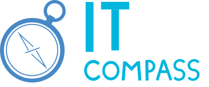

# 🧭 IT Compass

**IT Compass** is a web application designed to calculate ratings of Russian subjects for IT specialists, tailored to their qualification levels and based on objective metrics.

🚧 **Status:** Under active development.

## 🛠️ Tech Stack

## 📚 Documentation

> Note: All documentation files are written in **Russian**.

* [Project Specification](docs/spec.md)
* [Scoring Methodology](docs/scoring-methodology.md)
* [Glossary](docs/GLOSSARY.md)

## 🗺️ Roadmap

* [x] Define and analyze subject domain
* [x] Design database schema
* [x] Devise scoring methodology
* [x] Set up PostgreSQL via Docker Compose
* [x] Implement database models and constraints with SQLAlchemy
* [ ] Configure database migrations with Alembic
* [ ] Seed reference tables (regions, metrics, grades, and weights)
* [ ] Write a CLI script for database management (`setup`, `clear`, `refresh`)
* [ ] Implement the `/subjects` endpoint with filtering by district and subject
* [ ] Implement the `/subjects/{subject_slug}` endpoint
* [ ] Implement the `/subjects/compare` endpoint for comparing two subjects
* [ ] Implement the `/subjects/rating` endpoint

## 🪪 License

Distributed under the MIT License. See `LICENSE.txt` for more information.
