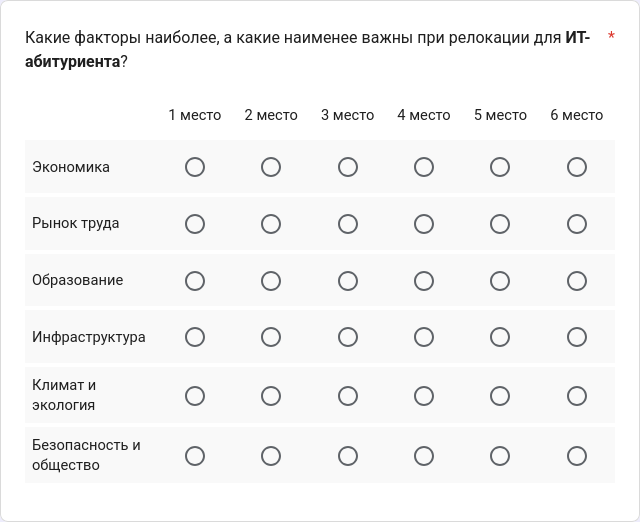

# IT Compass — Методология скоринга

## Общая информация

* **Автор документа:** Степан Ногтев
* **Связанные документы:**
  * [`GLOSSARY.md`](./GLOSSARY.md) — глоссарий
  * [`spec.md`](./spec.md) — спецификация

## Назначение

Документ фиксирует четыре ключевых решения, от которых зависит итоговый рейтинг регионов:

1. **Какие метрики** участвуют в расчёте рейтинга регионов.
2. **Какие веб-ресурсы** выступают в качестве источников данных для сырых записей метрик.
3. **Как нормализуются** сырые записи метрик для приведения к единой шкале.
4. **Какие веса** получает каждая метрика для каждого грейда.

На основе этих решений составляется тоговый рейтинг регионов.

## Отбор метрик

### Классификация метрик

Метрики проекта разделены по категориям:

| Категория | Назначение |
| :-------- | :--------- |
| **Экономические** | Насколько выгодно жить и работать |
| **Рыночно-трудовые** | Насколько легко найти работу и сменить её |
| **Образовательные** | Насколько доступно профильное образование |
| **Инфраструктурные** | Насколько развита и современна инфраструктура |
| **Климатическо-экологические** | Насколько благоприятна среда для здоровья |
| **Социально-демографические** | Насколько безопасна и благополучна социальная среда |

### Метрики по категориям

<table>
  <thead>
    <tr>
      <th>Категория</th>
      <th>Метрика</th>
      <th>Направление</th>
      <th>Разбивка по грейдам</th>
      <th>Источник данных</th>
    </tr>
  </thead>
  <tbody>
    <tr>
      <td rowspan="3"><b>Экономические</b></td>
      <td>Медианная зарплата ИТ-специалиста</td>
      <td>Прямая</td>
      <td>Да</td>
      <td><a href="https://career.habr.com/salaries">Хабр Карьера</a></td>
    </tr>
    <tr>
      <td>Стоимость фиксированного набора потребительских товаров и услуг</td>
      <td>Обратная</td>
      <td>Нет</td>
      <td><a href="https://showdata.rosstat.gov.ru/finder/descriptors/274286">Росстат</a></td>
    </tr>
    <tr>
      <td>Медианная цена 1 м² жилья на вторичном рынке</td>
      <td>Обратная</td>
      <td>Нет</td>
      <td><a href="https://blog.domclick.ru/analytics/detailed/offers/rossiya-rejting-vtorichka-bez-ucheta-komnat?periodStart=2026-09-01&topSlugs[]=offers_med_square_price&topSlugs[]=offers_sale_cnt&topSlugs[]=offers_exp_dur">Домклик</a></td>
    </tr>
    <tr>
      <td rowspan="3"><b>Рыночно-трудовые</b></td>
      <td>Соотношение активных резюме к активным вакансиям в ИТ-профобласти</td>
      <td>Обратная</td>
      <td>Нет</td>
      <td><a href="https://stats.hh.ru/?hhIndexProfArea=information_technology">hh Статистика</a></td>
    </tr>
    <tr>
      <td>Количество ИТ-вакансий на 100 тыс. населения</td>
      <td>Прямая</td>
      <td>Да</td>
      <td><a href="https://hh.ru/search/vacancy?search_field=name&search_field=description&enable_snippets=true&hhtmFrom=vacancy_search_list&professional_role=156&professional_role=160&professional_role=10&professional_role=12&professional_role=150&professional_role=25&professional_role=165&professional_role=34&professional_role=36&professional_role=73&professional_role=155&professional_role=96&professional_role=164&professional_role=104&professional_role=157&professional_role=107&professional_role=112&professional_role=113&professional_role=148&professional_role=114&professional_role=116&professional_role=121&professional_role=124&professional_role=125&professional_role=126&hhtmSource=vacancy_search_list&hhtmSourceLabel=vacancy_search_list&hhtmFromLabel=drawer_filter&L_save_area=true&customDomain=1&overRideDomainAreaId=1">hh.ru</a></td>
    </tr>
    <tr>
      <td>Количество аккредитованных ИТ-компаний</td>
      <td>Прямая</td>
      <td>Нет</td>
      <td><a href="https://compass.kontur.ru/templates/03447a54-4680-4bbc-900a-c6466c722f72?category=IT">Контур</a></td>
    </tr>
    <tr>
      <td rowspan="2"><b>Образовательные</b></td>
      <td>Количество вузов с ИТ-направлениями</td>
      <td>Прямая</td>
      <td>Нет</td>
      <td><a href="https://provuz.ru/vuz/region/">ПроВуз</a></td>
    </tr>
    <tr>
      <td>Количество ссузов с ИТ-направлениями</td>
      <td>Прямая</td>
      <td>Нет</td>
      <td><a href="https://provuz.ru/vuz/region/">ПроВуз</a></td>
    </tr>
    <tr>
      <td rowspan="2"><b>Инфраструктурные</b></td>
      <td>Доля абонентов домашнего интернет со скоростью 100 Мбит/с</td>
      <td>Прямая</td>
      <td>Нет</td>
      <td><a href="https://fedstat.ru/indicator/58417?id=58417">Минцифры</a></td>
    </tr>
    <tr>
      <td>Количество коворкингов на 100 тыс. населения</td>
      <td>Прямая</td>
      <td>Нет</td>
      <td><a href="https://www.kovorkingi.ru/">Коворкинги.ру</a></td>
    </tr>
    <tr>
      <td rowspan="2"><b>Климатическо-экологические</b></td>
      <td>Концентрация PM2.5</td>
      <td>Обратная</td>
      <td>Нет</td>
      <td><a href="https://www.iqair.com/ru/">IQAir</a></td>
    </tr>
    <tr>
      <td>Количество солнечных дней в году</td>
      <td>Прямая</td>
      <td>Нет</td>
      <td><a href="https://relocat.io/reytingi/solnechnye/">relocat</a></td>
    </tr>
    <tr>
      <td rowspan="2"><b>Социально-демографические</b></td>
      <td>Количество преступлений на 10 тыс. населения</td>
      <td>Обратная</td>
      <td>Нет</td>
      <td><a href="https://riarating.ru/infografika/20260119/630291420.html">РИА Рейтинг</a></td>
    </tr>
    <tr>
      <td>Естественный прирост/убыль населения на тыс. населения</td>
      <td>Прямая</td>
      <td>Нет</td>
      <td><a href="https://rosstat.gov.ru/compendium/document/13269">Росстат</a></td>
    </tr>
  </tbody>
</table>

## Нормализация сырых записей метрик

Чтобы привести все сырые записи метрик к единой шкале от 1 до 100 и корректно рассчитать рейтинг регионов, в проекте используется метод **линейной нормализации** (Min-Max нормализация).

### Формулы

**1.** В зависимости от направления метрики базовая формула (приведение к стандартному диапазону [0, 1]) принимает вид:

* **Прямая метрика**:

```math
\text{normalized\_score} = \frac{\text{raw\_value} - \text{raw\_value}_{\min}}{\text{raw\_value}_{\max} - \text{raw\_value}_{\min}}
```

* **Обратная метрика**:

```math
\text{normalized\_score} = \frac{\text{raw\_value}_{\max} - \text{raw\_value}}{\text{raw\_value}_{\max} - \text{raw\_value}_{\min}}
```

**2.** Для приведения сырых записей метрик к целевому диапазону [1, 100] формула видоизменяется следующим образом:

* **Прямая метрика**:

```math
\text{normalized\_score} = 1 + \frac{\text{raw\_value} - \text{raw\_value}_{\min}}{\text{raw\_value}_{\max} - \text{raw\_value}_{\min}} \cdot 99
```

* **Обратная метрика**:

```math
\text{normalized\_score} = 1 + \frac{\text{raw\_value}_{\max} - \text{raw\_value}}{\text{raw\_value}_{\max} - \text{raw\_value}_{\min}} \cdot 99
```

### Расшифровка обозначений

* `normalized_score` — нормализованная запись метрики
* `raw_value` — сырая запись метрики
* <code>raw_value<sub>min</sub></code> — минимальная сырая запись метрики
* <code>raw_value<sub>max</sub></code> — максимальная сырая запись метрики

## Распределение весов

Для определения весов категорий метрик проводится **опрос** аудитории, вовлеченной в IT-сферу. В рамках него респонденты **ранжируют** категории метрик по степени их важности для каждого грейда.

Опрос реализован на базе веб-сервиса Google Формы и состоит из пяти однотипных вопросов — по одному для каждого грейда. В каждом вопросе используется табличная сетка: респондент распределяет категории по степени важности, присваивая каждой из них место, где первое место — самое важное, а шестое место — наименее важное. Каждой категории можно присвоить только одно место, а каждому месту соответствует строго одна категория.

<div align="center">



*Рисунок 1 — Пример вопроса для грейда «Абитуриент» в Google Формах*

</div>
