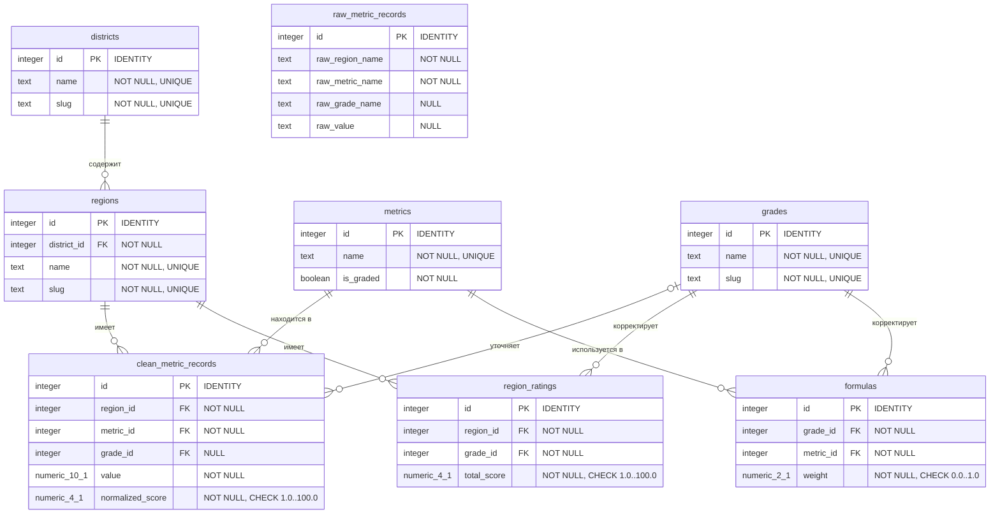

# IT Compass — Спецификация проекта

## Общая информация

* **Тип разработки:** Greenfield
* **Состояние проекта:** Частичная реализация
* **Автор документа:** Степан Ногтев
* **Связанные документы:** [`scoring-methodology.md`](./scoring-methodology.md) — методология отбора метрик и настройки весов

## Краткое описание

Веб-приложение для расчёта рейтинга российских регионов для ИТ-специалистов с учётом их квалификации на основе объективных метрик. Помогает ИТ-специалистам выбрать регион для жизни и работы.

## Анализ предметной области

### Проблематика

* **Основной пользователь:** Российские ИТ-специалисты, выбирающие регион для работы и жизни.
* **Ключевая проблема:** Большинство ИТ-вакансий в России (около 65%) приходится на офисный формат работы[^1], что делает выбор региона проживания фактором, напрямую влияющим на карьерные перспективы.

### Цели проекта

* **Ценностное предложение:** Прозрачный рейтинг регионов на основе измеримых метрик, персонализированный по уровню квалификации.
* **Бизнес-цель:** Отсутствует — учебный проект.

### Целевая аудитория

Целевая аудитория проекта сегментирована по грейду:

| Сегмент | Цель релокации | Сложности релокации |
| :------ | :------------- | :------------------ |
| **Абитуриент** | Поступить в ведущее образовательное учреждение и попасть в IT-среду | Высокая конкуренция среди поступающих, дорогое жильё, оторванность от семьи |
| **Стажёр** | Пройти стажировку и получить первый коммерческий опыт | Стажировка ограничена по длительности, отсутствие гарантии трудоустройства, низкий уровень оплаты труда |
| **Junior** | Закрепиться в профессии и выйти на стабильный доход | Небольшой опыт и отсутствие финансовой подушки — сложно пережить резкую потерю работы |
| **Middle** | Повысить доход и улучшить условия жизни | Есть что терять: текущая работа и быт, в то время как рост дохода на новом месте не гарантирован |
| **Senior** | Обеспечить семью и выйти на высокий уровень жизни | Переезд затрагивает партнёра и детей: партнёру искать работу заново, детям — менять детский сад или школу |

### Ограниченные контексты

| Подсистема | За что отвечает | Ключевые понятия |
| :--------- | :-------------- | :--------------- |
| Источники данных | Сбор и проверка метрик | `regions`, `raw_metric_records`, `metrics` |
| Рейтинг регионов | Нормализация данных, расчёт баллов и отображение на сайте | `regions`, `metrics`, `grades`, `formulas`, `clean_metric_records`, `region_ratings` |

### Ключевые рабочие процессы

| Процесс | Что запускает | Основные шаги |
| :------ | :------------ | :------------ |
| **1. Импорт сырых данных** | Консольная программа (Этап 1) | **1.** Полностью очистить старые записи в таблице `raw_metric_records`, если таковые имеются → **2.** Скачать CSV-версию Google Таблицы с сырыми данными по ссылке → **3.** Считать строки из файла и сохранить в таблицу `raw_metric_records`. |
| **2. Валидация и нормализация** | Консольная программа (Этап 2, автоматически после Этапа 1) | **1.** Считать все сырые данные из `raw_metric_records` → **2.** Проверить названия регионов и метрик по справочникам `regions` и `metrics` и отсечь строки со значением «Нет данных» → **3.** Конвертировать метрики в числа и нормализовать их в баллы от 1.0 до 100.0 → **4.** Записать результат в таблицу `clean_metric_records`. |
| **3. Расчёт итогового рейтинга** | Консольная программа (Этап 3, автоматически после Этапа 2) | **1.** Считать нормализованные баллы из `clean_metric_records` → **2.** Рассчитать общий балл по каждому региону на основе весовых коэффициентов из таблицы `formulas` → **3.** Сохранить финальный результат в таблицу `region_ratings`. |
| **4. Просмотр рейтинга с фильтрацией** | Открытие сайта | **1.** Выбрать грейд из `grades` (обязательно) → **2.** Настроить фильтр (опционально): выбрать один федеральный округ из `districts` ИЛИ выбрать один конкретный регион из `regions` (если ничего не выбрано — выводятся все регионы России) → **3.** Получить из БД отфильтрованные данные из `region_ratings` → **4.** Отобразить данные на сайте. |

## Проектирование базы данных (Концептуальный и логический этапы)

> **Примечание:** База данных спроектирована под СУБД **PostgreSQL**.

### Сущности и атрибуты

#### Справочные сущности

##### Федеральные округа (districts)

| Поле | Тип данных | Ограничения | Описание |
| :--- | :--------- | :---------- | :------- |
| `id` | integer | PK, IDENTITY | Первичный ключ, генерируется автоматически |
| `name` | text | NOT NULL, UNIQUE | Название федерального округа |
| `slug` | text | NOT NULL, UNIQUE | Человекопонятный URL |

##### Регионы (regions)

| Поле | Тип данных | Ограничения | Описание |
| :--- | :--------- | :---------- | :------- |
| `id` | integer | PK, IDENTITY | Первичный ключ, генерируется автоматически |
| `district_id` | integer | FK, NOT NULL | ID федерального округа из сущности `districts` |
| `name` | text | NOT NULL, UNIQUE | Название региона |
| `slug` | text | NOT NULL, UNIQUE | Человекопонятный URL |

##### Метрики (metrics)

| Поле | Тип данных | Ограничения | Описание |
| :--- | :--------- | :---------- | :------- |
| `id` | integer | PK, IDENTITY | Первичный ключ, генерируется автоматически |
| `name` | text | NOT NULL, UNIQUE | Название метрики |
| `is_graded` | boolean | NOT NULL | Разделяется ли метрика по грейдам |

##### Грейды (grades)

| Поле | Тип данных | Ограничения | Описание |
| :--- | :--------- | :---------- | :------- |
| `id` | integer | PK, IDENTITY | Первичный ключ, генерируется автоматически |
| `name` | text | NOT NULL, UNIQUE | Название грейда |
| `slug` | text | NOT NULL, UNIQUE | Человекопонятный URL |

#### Операционные сущности

##### Сырые записи метрик (raw_metric_records)

| Поле | Тип данных | Ограничения | Описание |
| :--- | :--------- | :---------- | :--- |
| `id` | integer | PK, IDENTITY | Первичный ключ, генерируется автоматически |
| `raw_region_name` | text | NOT NULL | Название региона из CSV |
| `raw_metric_name` | text | NOT NULL | Название метрики из CSV |
| `raw_grade_name` | text | NULL | Название грейда из CSV |
| `raw_value` | text | NULL | Значение метрики из CSV |

##### Очищенные записи метрик (clean_metric_records)

| Поле | Тип данных | Ограничения | Описание |
| :--- | :--------- | :---------- | :--- |
| `id` | integer | PK, IDENTITY | Первичный ключ, генерируется автоматически |
| `region_id` | integer | FK, NOT NULL | ID региона из сущности `regions` |
| `metric_id` | integer | FK, NOT NULL | ID метрики из сущности `metrics` |
| `grade_id` | integer | FK, NULL | ID грейда из сущности `grades` (пусто для общих метрик) |
| `value` | numeric(10,1) | NOT NULL | Валидированное числовое значение (один знак после точки) |
| `normalized_score` | numeric(4,1) | NOT NULL, CHECK (normalized_score >= 1.0 AND normalized_score <= 100.0) | Нормализованный балл региона (от 1.0 до 100.0) |

* **Ограничение таблицы:** UNIQUE (`region_id`, `metric_id`, `grade_id`).

##### Итоговые рейтинги (region_ratings)

| Поле | Тип данных | Ограничения | Описание |
| :--- | :--------- | :---------- | :--- |
| `id` | integer | PK, IDENTITY | Первичный ключ, генерируется автоматически |
| `region_id` | integer | FK, NOT NULL | Связь со справочником `regions` |
| `grade_id` | integer | FK, NOT NULL | Связь со справочником `grades` |
| `total_score` | numeric(4,1) | NOT NULL, CHECK (total_score >= 1.0 AND total_score <= 100.0) | Общий балл региона для конкретного грейда (один знак после точки) |

* **Ограничение таблицы:** UNIQUE (`region_id`, `grade_id`).

#### Конфигурационные сущности

##### Формулы (formulas)

| Поле | Тип данных | Ограничения | Описание |
| :--- | :--------- | :---------- | :--- |
| `id` | integer | PK, IDENTITY | Первичный ключ, генерируется автоматически |
| `grade_id` | integer | FK, NOT NULL | ID грейда из сущности `grades` |
| `metric_id` | integer | FK, NOT NULL | ID метрики из сущности `metrics` |
| `weight` | numeric(2,1) | NOT NULL, CHECK (weight >= 0.0 AND weight <= 1.0) | Вес метрики (от 0.0 до 1.0, один знак после точки) |

* **Ограничение таблицы:** UNIQUE (`grade_id`, `metric_id`).

### ER-диаграмма

## Примечания

[^1]: [I квартал 2026: вакансий меньше, но работать некому - Исследовательский центр портала SuperJob.ru](https://www.superjob.ru/research/articles/115719/i-kvartal-2026/)
